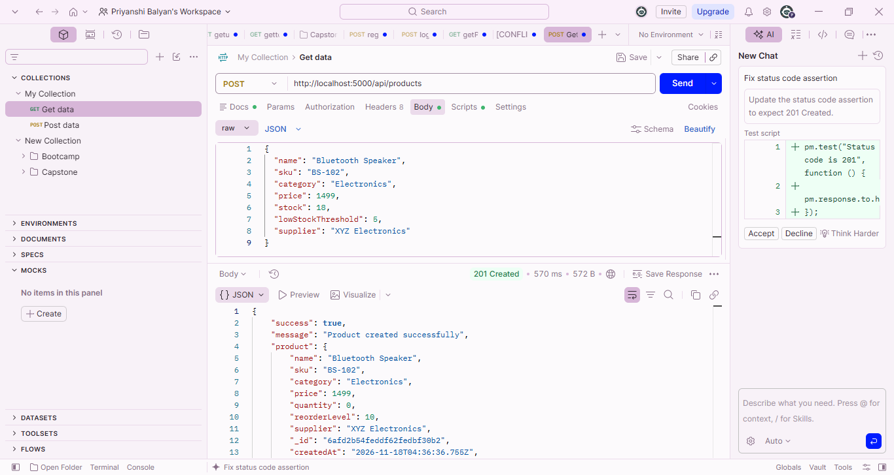
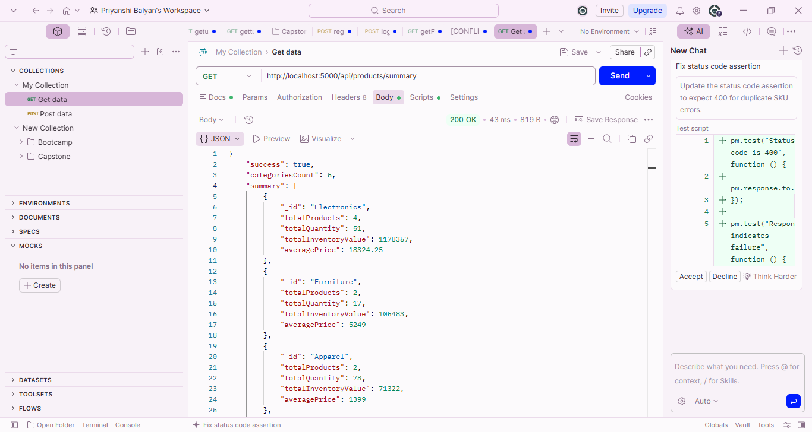
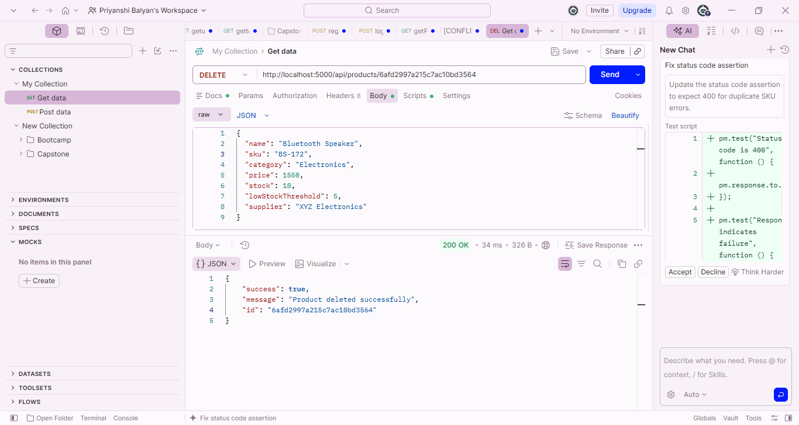
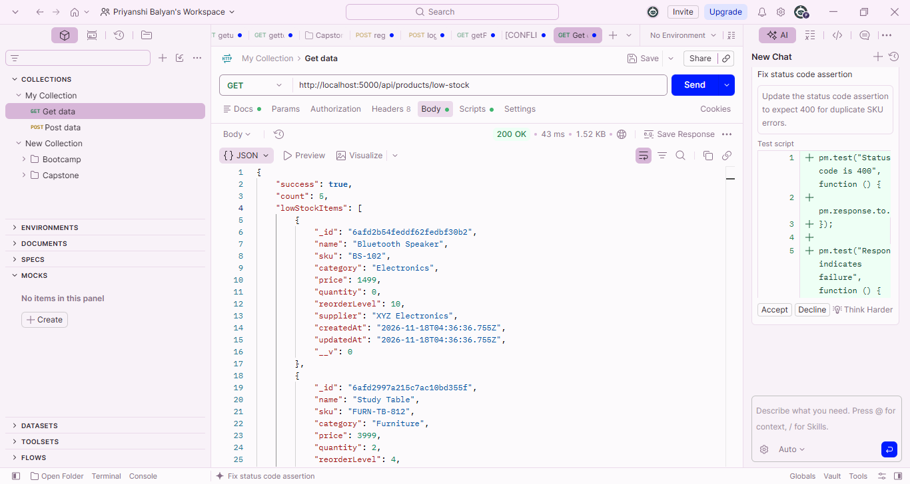

| Feature / Objective | Implementation File | Details |
|---|---|---|
| **1. Product Schema & Validation** | `models/Product.js` | Schema with validation (`required`, `unique`, `min`, `trim`, `timestamps`). |
| **2. Database Connection** | `config/db.js` | Clean async connection using Mongoose and `process.env.MONGO_URI`. |
| **3. CRUD Operations** | `controllers/productController.js` | Create, Read (all/single), Update, and Delete endpoints. |
| **4. Filtering, Sorting & Pagination** | `controllers/productController.js` | Query parameters for category, supplier, search, price, stock, sort, and pages. |
| **5. Stock Restock & Sale Operations** | `controllers/productController.js` | Safe stock adjustments (`PATCH /api/products/:id/stock`) preventing negative stock. |
| **6. Low-Stock Alert Report** | `controllers/productController.js` | Returns products where `quantity <= reorderLevel`. |
| **7. Aggregation Summary** | `controllers/productController.js` | Category-wise aggregation report using `$group`, `$sum`, `$multiply`, `$avg`. |
| **8. Centralized Error Handling** | `middleware/errorHandler.js` | Catches 404 routes, Mongoose validation errors, and duplicate key issues. |
| **9. Input Validation Middleware** | `middleware/validateObjectId.js` | Validates MongoDB ObjectId format before hitting the controller. |
| **10. Environment Management** | `.env` / `server.js` | Secure configuration using `dotenv`. |

---

## Project Structure

```text
Assignment-3/
│
├── config/
│   └── db.js                  # MongoDB database connection
│
├── controllers/
│   └── productController.js   # All 8 business logic functions (CRUD, stock, reports)
│
├── middleware/
│   ├── errorHandler.js        # Centralized 404 and error handler
│   └── validateObjectId.js    # Checks if :id is a valid MongoDB ObjectId
│
├── models/
│   └── Product.js             # Mongoose schema with field-level validation
│
├── routes/
│   └── productRoutes.js       # Express router linking endpoints to controllers
│
├── .env                       # Environment variables (PORT, MONGO_URI)
├── .env.example               # Template for environment configuration
├── package.json               # Dependencies (express, mongoose, dotenv)
├── seed.js                    # Script to populate 12 sample products
└── server.js                  # Main server entry file
```

---

##  How to Run the Project

### 1. Install Dependencies
```bash
npm install
```

### 2. Configure Environment (`.env`)
Make sure your `.env` contains:
```env
PORT=
MONGO_URI=
```

### 3. Insert Sample Data
```bash
npm run seed
```

### 4. Start Server
- **Development mode (auto-reloads on save):**
  ```bash
  npm run dev
  ```
- **Standard mode:**
  ```bash
  npm start
  ```
Server runs on: `http://localhost:5000`

---

##  API Endpoints Reference

| Method | Endpoint | Description |
|---|---|---|
| `GET` | `/api/products` | Get products (filter, sort, search, paginate) |--->
)

| `POST` | `/api/products` | Create a new product | --> 


| `GET` | `/api/products/:id` | Get single product by ID |
)


| `PUT` | `/api/products/:id` | Update product details |
)

| `PATCH` | `/api/products/:id/stock` | Adjust stock |


| `DELETE` | `/api/products/:id` | Delete product by ID |


| `GET` | `/api/products/low-stock` | Low-stock alert report  |


| `GET` | `/api/products/summary` | Category-wise aggregation summary |

---
